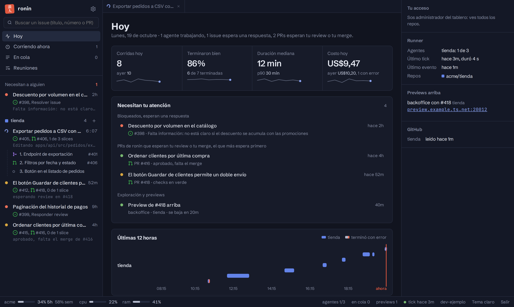
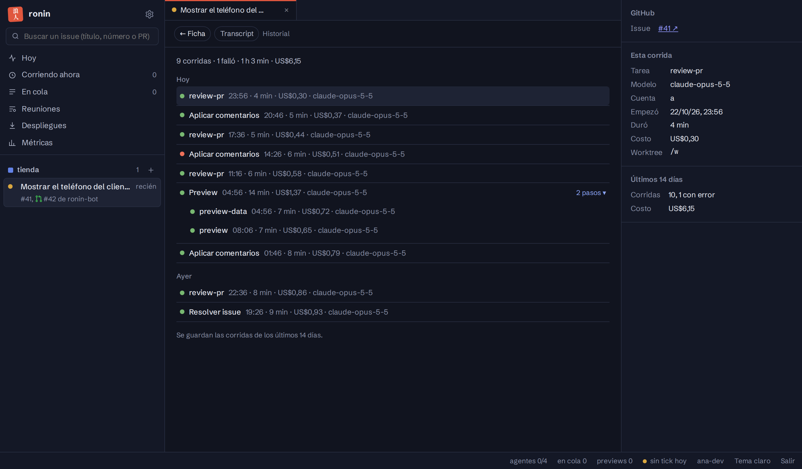

import { Aside, CardGrid, LinkCard } from '@astrojs/starlight/components';

Una página con lo que está haciendo ronin. Desde ahí también se le piden los comandos más usados, se deciden sus PRs, se revisa cualquier PR archivo por archivo, se siguen las exploraciones y, quien tenga permiso, se despliega. Se ve solo por la tailnet y pide entrar con GitHub: **lo que le pidas a ronin desde ahí queda en ronin, a la vista de todos, y lo que es de GitHub (aprobar, cerrar, asignar, comentar) queda en GitHub a tu nombre.** Se actualiza sola, sin recargar la página.

## Hoy, la pantalla de inicio

- **Los números del día:** corridas, cuántas terminaron bien, duración mediana y costo, cada uno con una mini línea de la semana.
- **Necesitan tu atención:** los issues bloqueados con su motivo, los PRs de ronin que esperan tu review o tu merge (el que más espera primero), el PR de exploración y las previews. Cada fila abre su ficha.
- **El ciclo actual**, si el repo usa [Linear](/ronin/operar/linear/): cuántos issues están hechos, en review, bloqueados o sin empezar, el avance día por día, el desglose por proyecto y quién tiene lo que falta.
- **Las últimas 12 horas**, con cada corrida de agente. Un clic abre esa corrida.

## A la izquierda, los issues

- **Exploraciones:** cada app que ronin explora y su estado.
- **Cada repo**, con los issues de ronin y sus slices, y los issues sobre los que ronin trabajó en los últimos días, el más nuevo primero. El orden no cambia cuando ronin trabaja en uno: lo dice su punto. Cada fila dice lo que espera («esperando review en #881», «conflictos en #904», «aprobado, falta el merge de #401») y si tiene una preview: **preview** en verde cuando está lista para abrir, **preview…** mientras prepara los datos o se actualiza. Un issue bloqueado queda en su lugar, con el punto rojo. Cuando uno pasa a corriendo, bloqueado o esperando, su fila se ilumina un segundo para que se note. Uno que viene de un [pedido del portal](/ronin/guias/pedidos-del-portal/) en curso lleva su número, **P-n**; los pedidos que todavía no tienen issue están en *Pedidos del portal*.
- **Los PRs viven dentro de su issue:** el de una slice, el que lo cierra (`Closes #N`) o el que lleva su número en la rama (`feat/405-…`). El PR de una persona aparece en la fila del issue. Un clic en una slice abre la ficha de su PR, abierto o ya mergeado, con su título y «slice n de m de #N» para volver al issue.
- **El buscador** encuentra cualquier issue abierto del repo, de ronin o no, por título, número, `RED-n` o el número de uno de sus PRs. Con un número que no está en la lista ofrece **Abrir #N**, aunque esté cerrado o sea un PR sin issue.
- El botón **+** de cada repo crea un issue nuevo a tu nombre. Ver [Darle trabajo](/ronin/guias/darle-trabajo/).

## En el centro, la ficha

Arriba, una pestaña por ficha abierta. Lo que abrís (desde la barra lateral, *Hoy* o un pedido) reemplaza a la pestaña que estás viendo; desde *Hoy* u otra página abre una nueva. Para que una pestaña no se reemplace, fijala con su chinche o con doble clic. El PR de un issue se abre en la ficha de ese issue, en la pestaña del PR.

- **Su estado:** conflictos, checks y review del PR.
- **Lo que hicieron los agentes:** la última corrida, o la que está corriendo con sus últimos pasos en vivo, y las dos anteriores. El transcript completo, paso a paso, se abre desde ahí. Si hay más de tres, **Historial** las lista todas por día, con su hora, duración, costo y modelo, y arriba lo que suman: cuántas corridas, cuántas fallaron, el tiempo y el costo. Una preview aparece como una sola corrida con sus pasos plegados. Desde el historial se abre el transcript de cualquiera.

- **Pestañas** con la descripción del issue y la de su PR, cada una con sus comentarios debajo: los del issue en la del issue, y los comentarios y las reviews del PR en la del PR. Un issue que ya tiene un PR abre en la pestaña del PR, que cuenta qué se hizo y, en *Qué se pidió*, qué se pidió. La del PR dice dónde está (abierto, draft, mergeado o cerrado), si está aprobado y por quién, si tiene auto-merge, sus checks y si tiene conflictos.
- **Archivos**, con el diff del PR, para [revisarlo](/ronin/guias/revisar-un-pr/).
- **En un PR de ronin**, la descripción por secciones y las [tres decisiones](/ronin/guias/decidir-un-pr/) en el encabezado.
- **Acciones** (`M`), con lo que se le puede pedir en ese momento. Ver [Acciones del tablero](/ronin/referencia/acciones/).

## A la derecha y abajo

- **A la derecha:** los links al issue o PR en GitHub y a su issue de Linear; el motivo de un bloqueo y cómo destrabarlo; las slices con sus PRs y checks (el nombre de la slice abre la ficha de su PR, el número abre GitHub); la preview con su URL y su commit; los datos de la corrida (modelo, cuenta, duración, costo).
- **Abajo:** el uso de cada cuenta de Claude (ventana de 5 horas y semanal), los agentes corriendo, la cola, las previews y el último tick.

## Quién ve qué

- **Administradores** ven todos los repos, despliegan y manejan [Ajustes](/ronin/operar/ajustes/).
- **Cualquier otra persona** ve los repos de `repos.json` en los que puede gestionar issues (*triage* o más) en GitHub. El tablero lo vuelve a consultar cada 10 minutos: si le dan o le sacan acceso a un repo, lo sigue. Solo lectura no alcanza, porque el tablero muestra transcripts, costos y previews.
- **De un repo que no ves**, nada aparece: ni en la lista, ni en *Hoy*, ni en la búsqueda, la cola o el uso de las cuentas. Si lo pedís por número, responde que no existe.
- **Qué puede hacer cada uno en cada repo** lo dice [Ajustes → Usuarios](/ronin/operar/ajustes/#administración); sin configurar, todo menos desplegar.

<Aside type="note">
Para instalarlo y dar acceso, ver [Operar → El tablero](/ronin/operar/tablero/).
</Aside>

## Las otras páginas

<CardGrid>
  <LinkCard title="Pedidos del portal" description="Lo que la gente pide sin GitHub, con su actividad, su issue y su PR." href="/ronin/guias/pedidos-del-portal/" />
  <LinkCard title="Exploraciones" description="Las apps que ronin usa de noche y las fichas que propone." href="/ronin/guias/explorar-una-app/" />
  <LinkCard title="Reuniones" description="De las notas de una reunión a issues y proyectos." href="/ronin/guias/reuniones/" />
  <LinkCard title="Despliegues" description="Publicar un release de cada repo." href="/ronin/guias/desplegar/" />
  <LinkCard title="Métricas" description="Cómo se mueve el trabajo: tiempos, carga por persona y dónde se traba. Solo admins." href="/ronin/guias/metricas/" />
</CardGrid>
