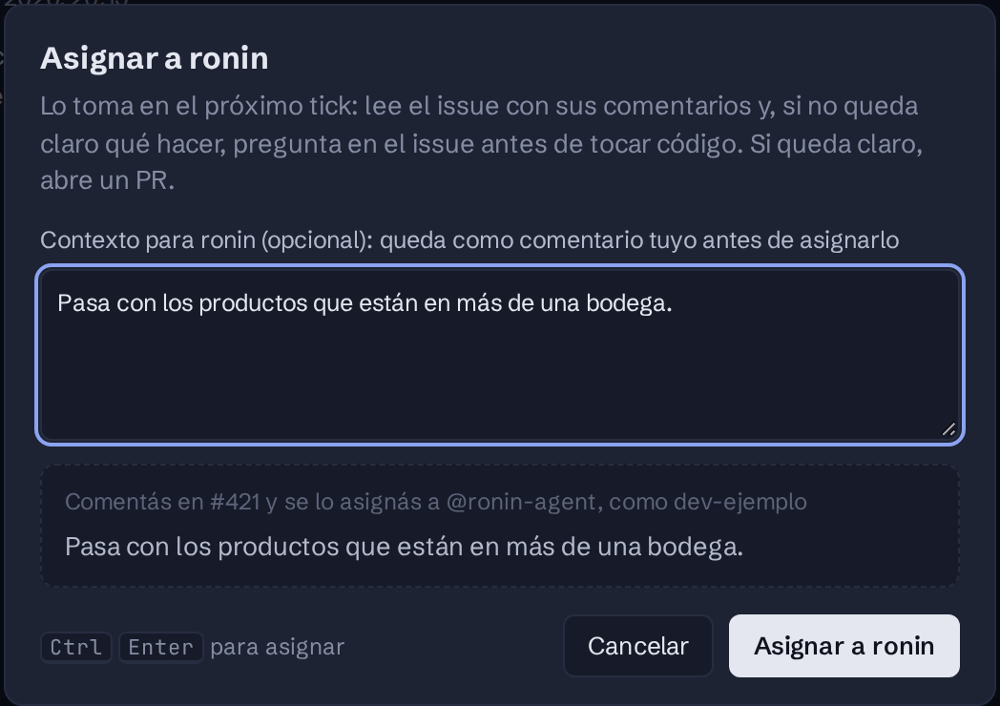

import { Aside, Steps, Tabs, TabItem, Badge } from '@astrojs/starlight/components';

Hay dos formas de darle trabajo: **un issue**, para un cambio acotado, o **un spec**, para algo grande que conviene trocear en varios PRs.

## Un issue

ronin lo lee entero, con sus comentarios, y:

- si es un bug, busca la causa raíz antes de tocar código;
- si le falta información, comenta en el issue pidiendo exactamente lo que necesita y espera (ver [Cuándo se bloquea](/ronin/referencia/bloqueos/));
- si está claro, abre un PR con `Closes #<n>`.

<Tabs syncKey="donde">
  <TabItem label="Desde el tablero" icon="laptop">
    <Steps>

    1. Abrí la ficha del issue. Si ronin todavía no lo tomó, el menú **Acciones** (`M`) ofrece **Asignar a ronin**, destacada.

    2. Si querés, escribí un contexto: el caso que falla, lo que ya probaste, por dónde empezar. Queda como un comentario tuyo en el issue, antes de asignarlo, así ronin lo lee.

    3. **Asignar a ronin** (`Ctrl ↵`). El diálogo te muestra antes qué va a pasar, con o sin comentario.

    </Steps>

    
  </TabItem>
  <TabItem label="Desde GitHub" icon="github">
    Asigná el issue a `ronin-agent` con el picker de **Assignees**. Si querés dejarle contexto, comentalo en el issue antes, sin mencionarlo: una mención se lee como un pedido aparte.
  </TabItem>
</Tabs>

<Aside type="note">
Un issue nuevo también se puede crear y asignar de una: el botón **+** de cada repo, en la barra lateral del tablero, lo crea a tu nombre y, si lo elegís, se lo asigna a ronin.
</Aside>

### Darle forma antes de asignarlo

En un issue que ronin todavía no tomó, podés pedirle que investigue o que prototipe, sin que abra un PR:

| | Qué hace | Desde el tablero | Desde GitHub |
|---|---|---|---|
| **Investigar** | Lee el código en solo lectura y agrega al issue una sección de contexto: archivos, hipótesis, preguntas abiertas. | *Acciones* → **Investigar (spike)**, eligiendo la app | `@ronin-agent /spike <app> [qué]` |
| **Prototipar** | Levanta la app, aplica un cambio borrador y deja en el issue las capturas del antes y el después, con el diff. | *Acciones* → **Prototipar**, eligiendo la app | `@ronin-agent /prototype <app> [qué]` |
| **Un pedido en palabras** | Ajusta el alcance, investiga o responde una pregunta. | — | `@ronin-agent <pedido>` |
| **Un spec** | Convierte el pedido en un spec y abre un PR draft con él. | — | `@ronin-agent /spec <app> [qué]` |

## Un spec

<Steps>

1. Escribí el spec como `.md` en `docs/superpowers/specs/` del repo del producto, en un PR **draft**.

2. Asigná ese PR a `ronin-agent`.

3. Cuando esté listo, marcalo **ready for review**. Esa es la señal de arranque: mientras siga en draft, ronin lo ignora y podés seguir iterando.

4. En el próximo tick, ronin mergea el spec, arma el plan en un issue de tracking y abre un PR por slice.

</Steps>

### Un spec que escribió ronin

Con `/spec`, ronin abre el PR draft por vos. Mientras siga en draft, podés conversarlo ahí: mencioná a `@ronin-agent` en un comentario general o en una línea del spec (por ejemplo, para sumar algo al alcance o discutir una decisión que tomó solo). ronin:

- si le pedís un cambio, edita el spec en un commit nuevo, sin reescribir lo anterior;
- te contesta en el mismo hilo qué cambió, o responde la pregunta;
- si le falta algo para decidir, te lo pregunta.

Mientras trabaja, el PR muestra el estado `ronin/spec`. Marcarlo *ready for review* sigue siendo la señal de arranque. Ningún comentario lo hace.

Por defecto va de a una slice: la siguiente arranca cuando se mergea la anterior. Con el label <Badge text="ronin:stack-prs" variant="note" /> en el issue de tracking, las apila sin esperar. Los PRs de slice salen con [auto-merge](/ronin/referencia/comandos/#auto-merge).
