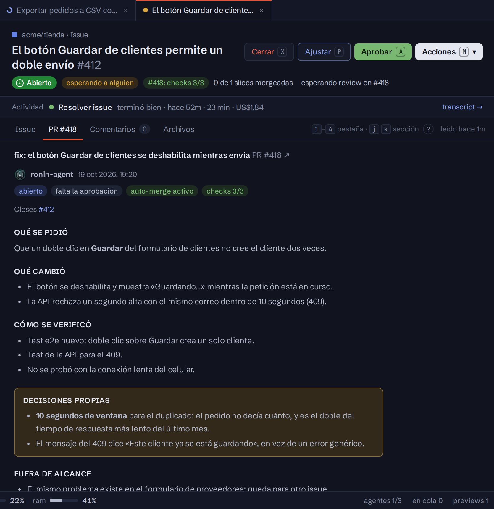
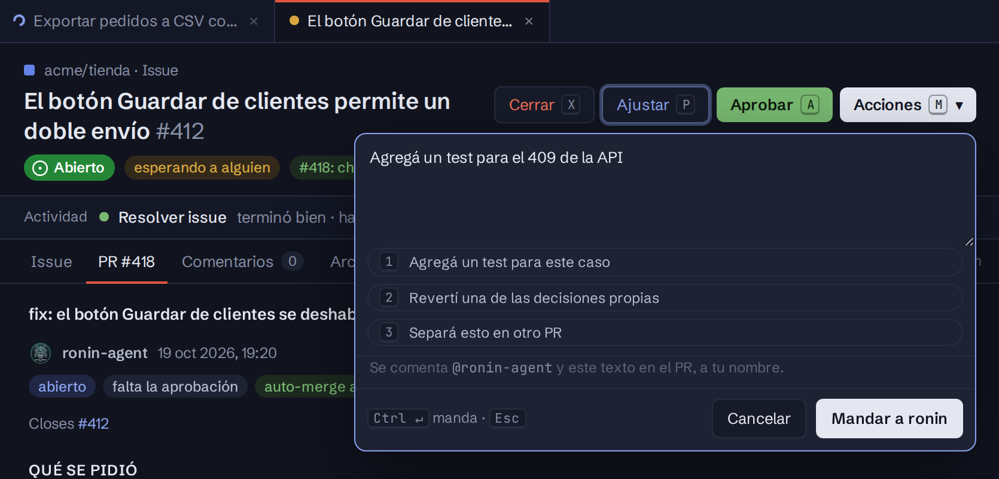

import { Aside, Card, CardGrid } from '@astrojs/starlight/components';

Un PR que abrió ronin se decide leyendo su descripción, no recorriendo el diff línea por línea. Siempre tiene las mismas secciones, y la pestaña **Descripción** del tablero las muestra por separado. Si le pedís un ajuste y cambia el código, ronin también pone al día la descripción, para que siga contando el PR como está:

| Sección | Qué dice |
|---|---|
| **Qué se pidió** | El pedido, con sus palabras. |
| **Qué cambió** | El cambio, con capturas cuando se ve. |
| **Cómo se verificó** | Lo que probó y lo que no. |
| **Decisiones propias** | Lo que el pedido no definía y ronin decidió por su cuenta, con el porqué. |
| **Fuera de alcance** | Lo que vio y dejó para otro PR. |

<Aside type="tip" title="Lo que más vale mirar">
Las **decisiones propias** van destacadas. Si una no te convence, es lo primero que conviene ajustar.
</Aside>

## Las tres decisiones

Están en el encabezado de la ficha, en todas las pestañas. Cada una se despliega debajo del botón y te dice qué se va a mandar, a tu nombre, antes de mandarlo.

<CardGrid>
  <Card title="Aprobar · A" icon="approve-check-circle">
    Aprueba el PR y le pide el auto-merge a ronin, que lo mergea cuando pasen los checks. Si ya tiene auto-merge o tiene conflictos, solo aprueba. `↵` confirma.
  </Card>
  <Card title="Ajustar · P" icon="pencil">
    Escribís qué debería cambiar y queda como `@ronin-agent <tu texto>`. ronin lo aplica y responde. `Ctrl ↵` manda.
  </Card>
  <Card title="Cerrar · X" icon="close">
    Un motivo opcional, que queda como comentario, y el PR cerrado. **Cerrar también el issue** viene marcado. `Ctrl ↵` confirma. Si el PR es de un [pedido del portal](/ronin/guias/pedidos-del-portal/) y cerrás también el issue, el motivo le llega a quien lo pidió, tal cual, en la conversación y por correo.
  </Card>
</CardGrid>

<Aside type="caution">
Si cerrás el PR y dejás el issue abierto, ronin lo bloquea y te avisa: se queda sin PR para seguir.
</Aside>

## Ajustar con comentarios en líneas

En un PR de ronin, la pestaña **Archivos** sirve para comentar líneas, pero no tiene **Terminar revisión**: tus comentarios pendientes los lleva **Ajustar**, y la barra dice cuántos hay. Al mandarlo, se manda tu revisión y después `@ronin-agent /fix-comments` con tu texto.

Mientras escribís, el texto no se pierde con los refrescos del tablero. Con el foco fuera del texto:

| Tecla | Qué hace |
|---|---|
| `1`–`3` | Suma una frase rápida al ajuste |
| `I` | Marca o desmarca *Cerrar también el issue* |
| `Ctrl ↵` | Manda |

Un PR de ronin en draft (un spec) se revisa como el de una persona: ver [Revisar el PR de una persona](/ronin/guias/revisar-un-pr/).
