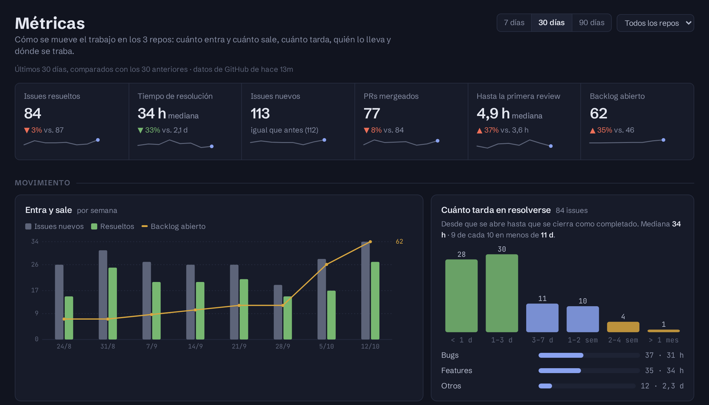
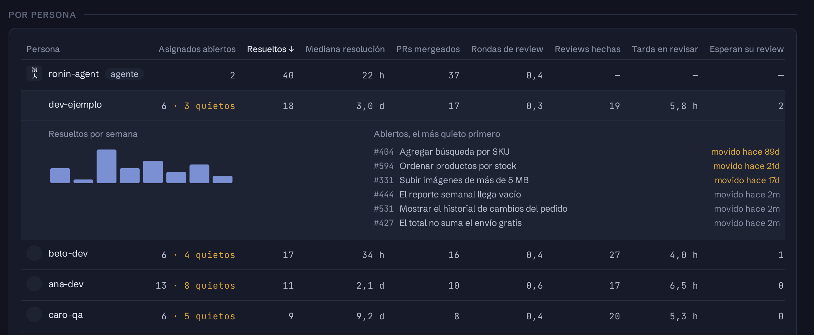
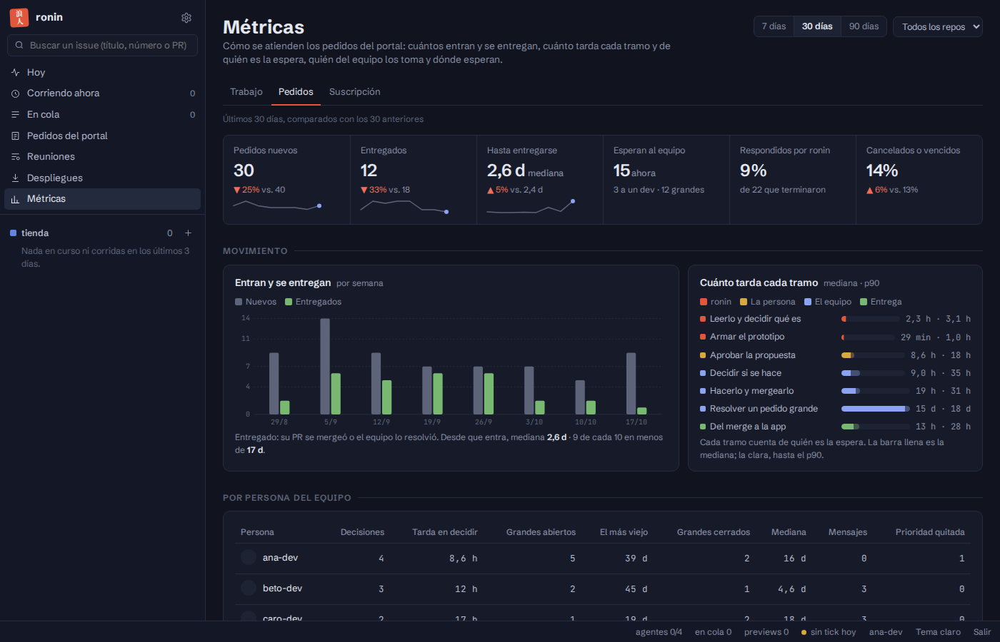
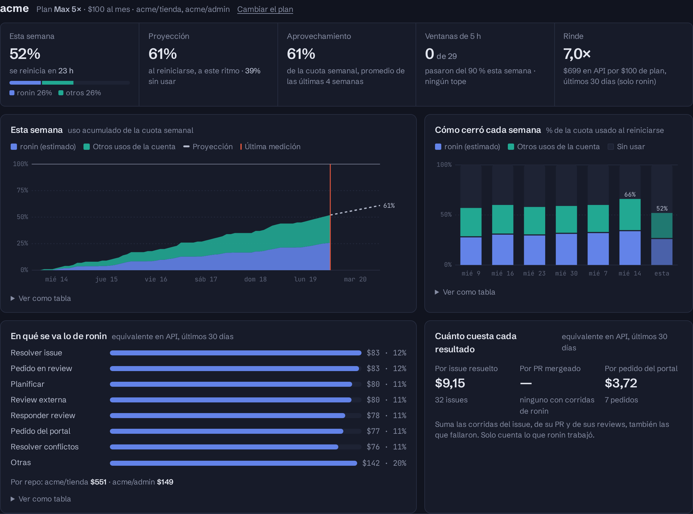

import { Aside } from '@astrojs/starlight/components';

**Métricas**, arriba a la izquierda en el tablero, tiene tres pestañas y solo la ven los administradores:

- **Trabajo** (`/metricas`): cómo se mueve el trabajo en los repos: cuánto entra y cuánto sale, cuánto tarda, quién lo lleva y dónde se traba.
- **[Pedidos](#pedidos)** (`/metricas/pedidos`): cómo se atienden los pedidos del portal: cuántos entran y se entregan, cuánto tarda cada tramo y de quién es la espera, quién del equipo los toma y dónde esperan.
- **[Suscripción](#suscripción)** (`/metricas/suscripcion`): cuánto se aprovecha cada cuenta de Claude con la que corre ronin.

Arriba elegís el **período** (7, 30 o 90 días) y el **repo**, o todos. Cada número se compara con el período anterior del mismo largo: en verde si mejoró, en rojo si empeoró.

<Aside type="note" title="Cómo se cuenta">
- **Resuelto** es un issue cerrado como completado. Los cerrados como *not planned* o duplicados se cuentan aparte y no entran en ningún tiempo.
- **Los tiempos son en días corridos:** un fin de semana cuenta.
- Los datos salen de GitHub y se actualizan cada 10 minutos. La página dice de cuándo son.
</Aside>

## Resumen y movimiento

- **Seis números**, cada uno con su tendencia:
  - issues resueltos;
  - tiempo de resolución (la mediana, desde que se abre el issue hasta que se cierra);
  - issues nuevos;
  - PRs mergeados;
  - hasta la primera review (la mediana);
  - backlog abierto.
- **Entra y sale:** los issues nuevos contra los resueltos, por semana o por día, con la línea del backlog. Si la línea sube, entra más de lo que sale.
- **Cuánto tarda en resolverse:**
  - cuántos issues tardan menos de un día, de 1 a 3 días, y así hasta más de un mes;
  - el tiempo en que se resuelven 9 de cada 10;
  - el tiempo por tipo (bug, feature u otro), según los labels del issue.

## Por persona

Una fila por cada persona con algo asignado, mergeado o revisado en el período. ronin tiene la suya, marcada como *agente*. La tabla sirve para ver la carga y dónde se traba el trabajo, no para comparar personas.

| Columna | Qué cuenta |
|---|---|
| Asignados abiertos | Lo que tiene ahora. En amarillo, cuántos llevan más de 14 días sin movimiento. |
| Resueltos | Issues asignados a la persona y cerrados como completados. Si un issue tiene dos personas asignadas, cuenta para las dos. |
| Mediana resolución | De esos issues. |
| PRs mergeados | Sus PRs que se mergearon. |
| Rondas de review | Cuántas veces, en promedio, le pidieron cambios a un PR suyo antes de mergearlo. |
| Reviews hechas | En cuántos PRs de otros dejó una review. |
| Tarda en revisar | Desde que le piden la review hasta que deja la primera. |
| Esperan su review | Los PRs abiertos que le pidieron revisar y todavía no revisó. |

Al tocar una fila se ven sus resueltos semana a semana y lo que tiene abierto, empezando por lo que lleva más tiempo sin moverse. Cada número abre su ficha.

Cada columna se ordena con un clic en su título.

## Salud del flujo

- **Antigüedad del backlog:**
  - los issues abiertos, por cuánto tiempo llevan abiertos;
  - cuántos no tienen a nadie asignado;
  - cuántos están asignados pero llevan 30 días sin moverse;
  - cuántos de los resueltos se reabrieron, y cuántos se cerraron sin hacer.
- **PRs esperando review:**
  - los que llevan más de 2 días con una review pedida y sin respuesta, con quién la tiene pendiente;
  - cuánto tarda un PR de que se abre a que se mergea;
  - qué parte se mergea sin que pidan cambios.
- **Despliegues:**
  - los releases publicados (sin contar los *pre-release*), por semana;
  - cuánto tarda un PR mergeado en llegar al próximo release.

  Un repo que no publica releases no aparece acá.

## ronin

- **Parte del trabajo:** qué parte de los issues resueltos fueron de ronin, y su tiempo de resolución comparado con el de las personas.
- **Sin ayuda:**
  - qué parte de lo que resolvió terminó sin [bloquearse](/ronin/referencia/bloqueos/);
  - sus PRs aprobados sin pedido de cambios;
  - sus intentos de fix por PR.
- **Por qué se bloqueó:** los bloqueos del período, agrupados por motivo. Los que son de antes de que ronin empezara a guardar el motivo aparecen como *Sin motivo registrado*.

## Pedidos

Usa el mismo período y el mismo repo que *Trabajo*. Los datos salen de cada pedido: sus fechas, sus eventos y la decisión del dev. El dueño de un pedido grande sale de GitHub: quien está asignado a su issue.

- **Seis números:**
  - pedidos nuevos;
  - entregados, es decir, con su PR mergeado o resuelto por el equipo;
  - hasta entregarse: la mediana desde que entra;
  - los que esperan al equipo ahora: la decisión de un dev, o grandes abiertos;
  - qué parte de los que terminaron respondió ronin sin nada que cambiar;
  - qué parte se canceló o venció sin respuesta.
- **Entran y se entregan:** por semana, o por día en el período de 7.
- **Cuánto tarda cada tramo:** la mediana y el p90 de cada tramo, de color según de quién es la espera:
  - **ronin:** leerlo, armar el prototipo, reproducir el error;
  - **la persona:** aprobar la propuesta;
  - **el equipo:** decidir si se hace, hacerlo y mergearlo, resolver un pedido grande;
  - **la entrega:** del merge a la app.

  La barra crece con la raíz cuadrada del tiempo, para que un tramo de minutos se vea al lado de uno de semanas.
- **Por persona del equipo:**
  - las decisiones que tomó un dev y cuánto tardó en tomarlas;
  - los pedidos grandes que tiene asignados, el más viejo, los que cerró y en cuánto;
  - los mensajes que le escribió a quien pidió;
  - las veces que quitó una prioridad.
- **Por cuenta del portal:** cuántos pedidos hizo cada cuenta, cuántos se entregaron, cuántos marcó como [prioritarios](/ronin/guias/pedidos-del-portal/#pedidos-prioritarios), a cuántos les quitaron la prioridad y cuántos se cancelaron o vencieron. Una cuenta a la que el equipo le quita la prioridad seguido está marcando de más.
- **Resultados:**
  - **Prioritarios:** cuántos se marcaron y a cuántos se les quitó la prioridad, y cuánto tarda un dev en decidir uno prioritario frente a uno normal.
  - **Calidad:** qué parte de las propuestas no le sirvió a la persona, cuántas propuestas lleva un pedido, qué parte decidió no hacerse un dev, qué parte de los errores se reprodujo y cuántos despliegues fallaron.
  - **Por app:** nuevos, entregados y la mediana hasta entregarse.
- **Dónde esperan, ahora:**
  - los que esperan a un dev hace más de 24 horas;
  - los grandes cuyo issue nadie tiene asignado;
  - los pedidos donde la persona respondió y nadie del equipo la leyó.

  Un clic en el número abre el pedido.

## Suscripción

Cuánto se aprovecha cada cuenta de Claude: cuánto de la cuota semanal se usa antes de que se reinicie, qué parte es de ronin y en qué se va. Cuenta **todo** lo que usa la cuenta, sea ronin o una persona con Claude Code. Las corridas que terminaron con la API key de su repo ([respaldo por API](/ronin/referencia/repos-json/#respaldo-por-api)) no usaron el plan y no cuentan. Arriba se elige una cuenta, o todas.

Para cada cuenta, su plan y su precio, que se cambian en [Ajustes → Cuentas de Claude](/ronin/operar/ajustes/#administración), y cinco números:

| Número | Qué cuenta |
|---|---|
| Esta semana | El % usado de la cuota semanal, partido en ronin y otros, y cuánto falta para que se reinicie. |
| Proyección | Con el ritmo de las últimas 48 horas, en qué % cerraría la semana, o qué día se agota. |
| Aprovechamiento | El % promedio en que cerraron las últimas 4 semanas, con todos los usos. Es el número principal. |
| Ventanas de 5 h | Cuántas pasaron del 90 % esta semana, y si alguna llegó al tope. |
| Rinde | Lo que habrían costado las corridas de ronin de los últimos 30 días pagando la API, dividido por el precio del plan. Solo cuenta ronin. |

Debajo:
- **Esta semana:** el uso acumulado, con ronin y otros apilados, la proyección hasta el reinicio y la última medición.
- **Cómo cerró cada semana:** las últimas 8 y la de ahora, con lo que quedó sin usar.
- **En qué se va lo de ronin:** el equivalente en API de los últimos 30 días, por tipo de tarea y por repo.
- **Cuánto cuesta cada resultado:** por issue resuelto, por PR mergeado y por pedido del portal. Suma las corridas del issue, de su PR y de sus reviews, también las que fallaron.

Cada gráfico muestra el valor al pasar el mouse (o al tocarlo en el teléfono) y tiene *Ver como tabla*.

<Aside type="note" title="Cómo se calcula">
- **El uso de la cuenta** lo informa Anthropic en cada corrida de ronin. Entre una corrida y otra no hay mediciones: lo que otros usen en ese rato aparece en la siguiente, y la página dice de cuándo es la última.
- **La parte de ronin es un estimado.** ronin sabe cuánto habría costado cada corrida suya en la API. En los ratos en que solo ronin usa la cuenta, eso dice cuánta cuota mueve cada dólar; lo que sube por encima de eso se asigna a otros usos. Hacen falta varias mediciones para tenerlo: hasta entonces, la página muestra el uso de toda la cuenta sin partirlo.
- **Las semanas** se cuentan desde que ronin empezó a guardar cada medición: el aprovechamiento aparece cuando cierra la primera.
</Aside>
