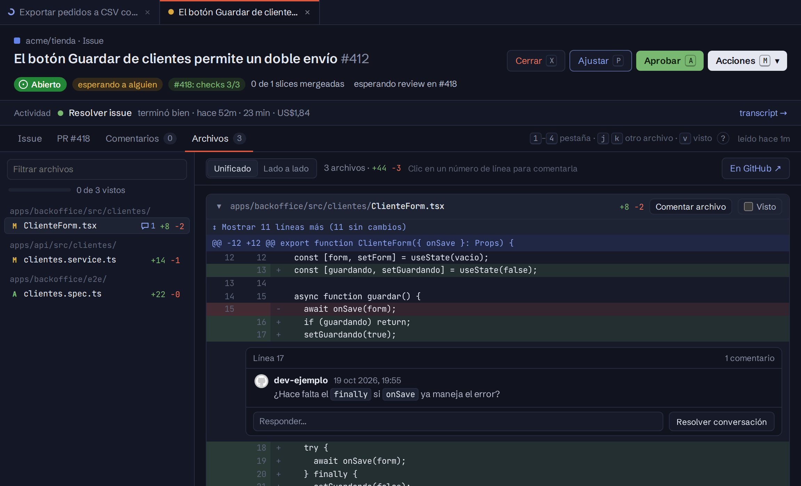

import { Aside } from '@astrojs/starlight/components';

La pestaña **Archivos** de la ficha de un PR es el *Files changed* de GitHub dentro del tablero. En un issue, muestra los del PR que avanza. Así se revisa el PR de una persona. Uno de ronin se decide desde su descripción: ver [Decidir un PR de ronin](/ronin/guias/decidir-un-pr/).

- **A la izquierda**, los archivos por carpeta, con filtro, sus `+`/`−`, las conversaciones sin resolver, lo que tenés pendiente (✎) y cuántos marcaste como vistos.
- **A la derecha**, el diff, unificado o lado a lado, con cada conversación bajo su línea. *Mostrar más líneas* abre el código de alrededor. Los diffs muy grandes y los archivos vistos empiezan plegados.
- `j`/`k` pasa de archivo, `v` lo marca como visto y salta al siguiente, `r` abre la revisión.

## Comentar

Todo queda en GitHub a tu nombre, igual que en *Files changed*:

| Qué | Cómo |
|---|---|
| **Comentar una línea** | Clic en su número. Con Shift+clic en otro número elegís varias. |
| **Comentar el archivo** | **Comentar archivo**, en su encabezado. |
| **Sugerir un cambio** | **± Sugerir cambio**, en el editor: pone el código de esas líneas para editarlo. En GitHub queda como sugerencia, con el botón para aplicarla. |
| **Conversaciones** | **Responder…**, **Resolver conversación** o **Reabrir**. |
| **Visto** | El mismo *Viewed* de GitHub. Si el archivo cambia, GitHub lo vuelve a marcar sin ver. |

## La revisión

Como en GitHub, podés **Comentar ya** o **Empezar una revisión**. Una revisión empezada es la revisión pendiente de GitHub: lo que sumás queda como *Pendiente* (con editar y borrar), nadie más lo ve, y la encontrás igual en github.com o en otro dispositivo.

Para mandarla, **Terminar revisión ▾** (arriba en la ficha, en la barra de Archivos, o `r`):

- un resumen opcional;
- **Comentar**, **Aprobar** o **Pedir cambios**. En tu propio PR solo podés comentar: GitHub no deja aprobarlo ni pedirle cambios;
- en un draft de ronin, **Que ronin los atienda ahora**: después de la revisión comenta `@ronin-agent /fix-comments` a tu nombre. Hace falta porque ronin no lee el resumen de una revisión;
- **Descartar** borra la revisión pendiente con todo lo que tenía.

Al aprobar o pedir cambios, el tablero lo muestra enseguida (*aprobado*, *cambios pedidos*) en la ficha, la lista, *Hoy* y el pedido, sin esperar a la próxima lectura de GitHub.

<Aside type="tip" title="Que ronin aplique los comentarios">
En el PR de una persona (no fork), `@ronin-agent /fix-comments` aplica en un solo pase todos los hilos abiertos. Ver [`/fix-comments`](/ronin/referencia/comandos/#fix-comments).
</Aside>

En un PR de exploración la revisión no aparece: se aprueba desde **Fichas**. Ver [Explorar una app](/ronin/guias/explorar-una-app/).
