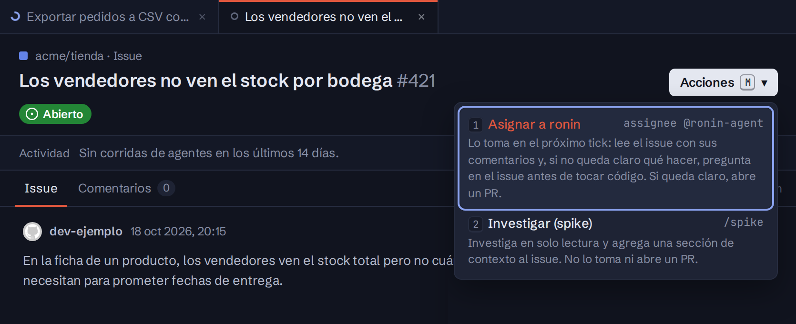

import { Aside } from '@astrojs/starlight/components';

El botón **Acciones** de la ficha (`M`) muestra lo que se le puede pedir a ronin sobre ese issue o PR en ese momento. El tablero escribe el comando por vos, **con tu cuenta de GitHub**: desde ahí es igual que si lo hubieras escrito en GitHub, ronin le pone 👀, lo hace y responde.

| Acción | Igual que | Cuándo aparece |
|---|---|---|
| **Asignar a ronin** | Asignar el issue a `ronin-agent` | Un issue abierto que ronin no gestiona. Destacada. Lleva un contexto opcional. |
| **Investigar (spike)** | `/spike <app> [qué]` | Igual que *Asignar*, en un repo con `ronin.app.json`. Se elige la app. |
| **Explorar** | `/explore <app> [en qué fijarse]` | Igual que *Investigar*. Usa la app con lo que pide el issue como foco y deja fichas en el PR de exploración, sin tocar el código. Ver [Explorar lo que pide un issue](/ronin/guias/explorar-una-app/#explorar-lo-que-pide-un-issue). |
| **Responder y destrabar** | Comentar y volver a `ronin:in-progress` | Un issue con `ronin:blocked`. Lleva tu respuesta, obligatoria. Destacada. |
| **Resolver conflictos** | `/resolve-conflicts` | Un PR abierto. Destacada si tiene conflictos con su base. |
| **Levantar o actualizar la preview** | `/preview [app] [qué preparar]` | Un PR abierto. Lleva un texto opcional. *Actualizar* la levanta de cero. Si el repo tiene varias apps, se elige una: viene marcada la que está arriba, o la única que cambia el PR. |
| **Bajar la preview** | `/preview stop` | Hay una preview arriba. |
| **Activar o desactivar el auto-merge** | `/auto-merge`, `/auto-merge off` | Según si el PR tiene `ronin:auto-merge`. |
| **Cerrar el issue** | *Close as not planned* en GitHub | Cualquier issue abierto. Va al final. Lleva un motivo opcional. |

En un issue, las acciones de PR van al PR de su slice que avanza («Resolver conflictos en #849»).

## Antes de pedirla

Un diálogo muestra el comentario que va a quedar, tal cual y a tu nombre, mientras escribís. `Ctrl ↵` comenta. Si mientras tanto la acción dejó de aplicar (alguien la pidió en GitHub, el PR se cerró), el tablero no comenta nada y te lo dice.

- **Asignar a ronin** deja tu contexto, si escribiste uno, como un comentario común en el issue, sin mencionar a ronin (una mención se leería como un pedido aparte). Después le asigna el issue. Si a ronin no le queda claro qué hacer, pregunta en el issue antes de tocar código.
- **Responder y destrabar** comenta tu respuesta y ronin le vuelve a poner `ronin:in-progress` al issue. Si GitHub rechazó el comentario, el label no se toca.
- **Cerrar el issue** deja el motivo, si escribiste uno, como un comentario común, y después lo cierra como no planeado. Si es el issue de un pedido del portal, el motivo también le llega a quien lo pidió, en la conversación y por correo. Si el issue tiene un PR abierto, el PR queda abierto: para cerrar los dos, usá **Cerrar** en el PR con *Cerrar también el issue* (ver [Decidir un PR](/ronin/guias/decidir-un-pr/)). Si ronin lo estaba trabajando, lo pasa a `ronin:done` en el próximo tick, salvo que siga abierto el PR de una de sus slices.

## Comentar

Al pie de la conversación de las pestañas **Issue** y **PR** hay un cuadro para comentar, como el de GitHub, sin diálogo: escribís, `Ctrl ↵` (o **Comentar**) y el comentario queda en GitHub a tu nombre y aparece en la conversación. `c` lleva el foco al cuadro y `Esc` lo saca. Lo que estabas escribiendo queda en el cuadro si te vas a otra ficha y volvés.

Es un comentario común: ronin lo lee con el resto de la conversación cuando trabaja el issue o el PR, así que sirve para ir dejándole contexto antes de asignarlo. Si mencionás a `@ronin-agent`, lo toma como un pedido, igual que en GitHub. Aparece para quien tiene el permiso de acciones en el repo.

## Nuevo issue

El botón **+** de cada repo, en la barra lateral, crea un issue en GitHub a tu nombre: título y descripción en Markdown, con vista previa. Después de crearlo, una de cuatro:

- solo crearlo;
- asignárselo a ronin, que lo toma como cualquier issue asignado;
- pedirle `/spike <app>` o `/spec <app>`, con una instrucción opcional.

Con [Linear](/ronin/operar/linear/) elegís, si querés, el proyecto y el ciclo: el issue se crea en GitHub y ronin se los pone apenas la sincronización lo lleva a Linear.

<Aside type="note">
Lo demás (`/fix-comments`, `/spec` en un issue existente, los pedidos en palabras) se sigue comentando en GitHub. Ver [Comandos](/ronin/referencia/comandos/). En un PR de ronin, los ajustes se piden con [**Ajustar**](/ronin/guias/decidir-un-pr/).
</Aside>
