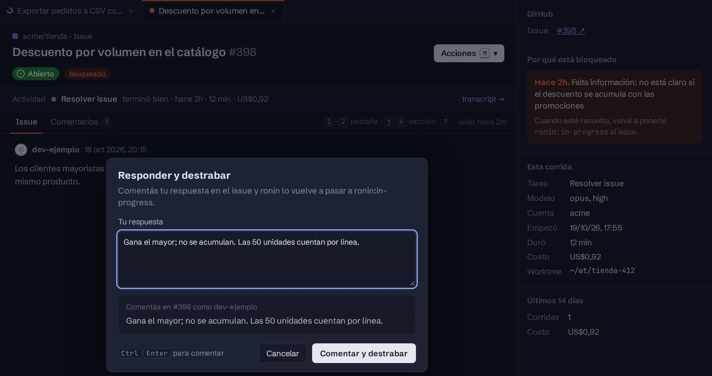

import { Aside, Steps } from '@astrojs/starlight/components';

«Bloqueado» significa que **ronin no puede seguir sin una decisión humana**. No es lo mismo que «esperando»: un PR esperando review o un CI corriendo son parte normal del ciclo y no generan aviso.

## Se bloquea y avisa

| Motivo | Cuándo |
|---|---|
| **E2E que no converge** | Los checks de una slice siguen fallando después de 2 intentos de fix. |
| **Review que no converge** | El PR sigue con cambios pedidos después de 3 intentos de fix. |
| **CI que nunca termina** | Los checks siguen pendientes durante 60 ticks, unas 5 horas. |
| **Stack sin retarget** | El PR del fondo del stack sigue apuntando a una rama que no es la raíz. |
| **Errores repetidos** | Procesar el issue falla varias veces seguidas con un error inesperado. |
| **Plan vacío o slices huérfanas** | El plan no dejó slices, o quedan slices sin mergear y ningún PR abierto. |
| **Falta información** | A un issue asignado le falta contexto para actuar sin adivinar. Las preguntas quedan en el issue. |

<Aside type="note">
Un pedido que contradice el spec no bloquea: si trae una razón concreta lo aplica, y si no, responde por qué no.
</Aside>

## Solo espera

- Un PR esperando review o aprobación.
- El CI corriendo o en cola.
- Comentarios de review accionables: los resuelve y sigue.
- Un PR aprobado y en verde esperando que alguien lo mergee.
- La cuota de Claude agotada: espera y se reanuda solo.

## Qué ves y cómo destrabarlo

El issue recibe el label `ronin:blocked`, y llega un email a quien eligió *Bloqueos* en [Ajustes → Notificaciones](/ronin/operar/ajustes/), con el link al issue y al PR, el motivo en una oración y el detalle, como cuántos intentos lleva contra qué límite.

<Steps>

1. Resolvé lo que falta. Si son preguntas, respondelas en el issue.

2. Volvé a pasar el issue a `ronin:in-progress`. Desde el tablero, **Acciones** → **Responder y destrabar** hace las dos cosas: comenta tu respuesta y mueve el label.

</Steps>

El criterio completo vive en [`docs/BLOCKING.md`](https://github.com/Oskr814/ronin/blob/main/docs/BLOCKING.md), versionado junto al código que lo implementa.
